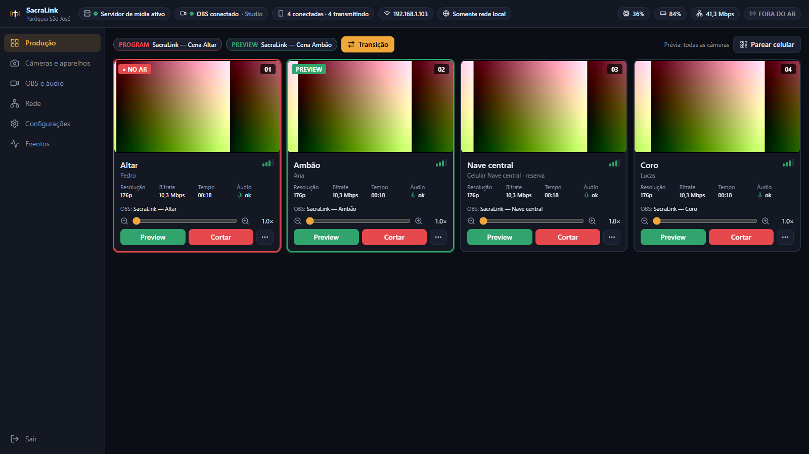

  

<h1 align="center">SacraLink</h1>

<b>Wireless Church Broadcasting System</b> 
Turn up to 8 Android/iPhone smartphones into wireless cameras for OBS Studio —
no VPS, no cloud relay, no Docker.

  <a href="README.md">Português (Brasil)</a> ·
  <a href="docs/architecture/00-plano-tecnico.md">Technical plan (pt-BR)</a> ·
  <a href="docs/mvp-checklist.md">MVP status (pt-BR)</a>

> **Status: pre-MVP, under active development.** The phone → server → OBS video
> path is implemented and covered by end-to-end tests with the real MediaMTX
> binary. **Validation with real phones and the real OBS Studio is still
> pending.** Primary documentation is in Portuguese.

## What it does

- **No app install needed**: point the phone camera at the QR code and the
  camera page opens in the browser (Chrome/Safari), served by the church PC
  itself. Phones publish H.264 + Opus over **WebRTC (WHIP)** straight to the
  church PC. The native Flutter app is optional (4G/5G, real lenses, pinning).
- A local **MediaMTX** (managed by SacraLink, loopback-only) remuxes to
  **RTSP** for OBS — no transcoding.
- One OBS source + scene per camera via **obs-websocket 5.x**, idempotent and
  never touching user-created sources.
- Real **tally** (ON AIR / PREVIEW / CONNECTED) computed from OBS Program and
  Preview, including **nested scenes and groups**; never a stale ON AIR when
  OBS disconnects.
- Remote zoom/lens/focus/torch/mic/quality with execution confirmation and a
  local-operator conflict policy.
- Works on a LAN without internet; 4G/5G works when there is a real inbound
  route (public IPv4 or IPv6). CG-NAT is detected and explained honestly.

## Stack

Go 1.27 (server, pure-Go SQLite, own obs-websocket client), MediaMTX v1.21,
Wails v2 + React 19 + TypeScript + Tailwind 4 (dashboard), Flutter 3.47 +
flutter_webrtc + native Kotlin/Swift plugin (mobile), Inno Setup 6 (installer).

## Security

Loopback-only admin API with bcrypt password and lockout; single-use 5-minute
pairing tokens (no passwords in the QR code, carried in the URL fragment);
TLS 1.3 with certificate pinning in the native app (the browser relies on the
user accepting the church PC's self-signed certificate); revocable device credentials stored as hashes; OBS password
encrypted with Windows DPAPI; remote access disabled by default.

## Known limitations

No remote access behind CG-NAT without IPv6 (no relay by design); the camera
stops in background/locked screen (OS restriction); optical zoom depends on the
device; the browser camera shows a certificate warning on first use, has no
4G/5G support yet and has not been tested on real phones yet (only with
headless Chromium and a fake camera); 8-camera support not yet validated on
real devices; unsigned binaries may be blocked by Windows Smart App Control.

## License

[MIT](LICENSE). Third-party licenses: [docs/licenses.md](docs/licenses.md).
