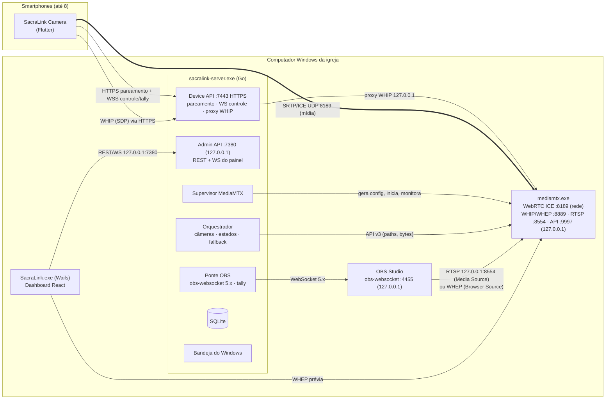
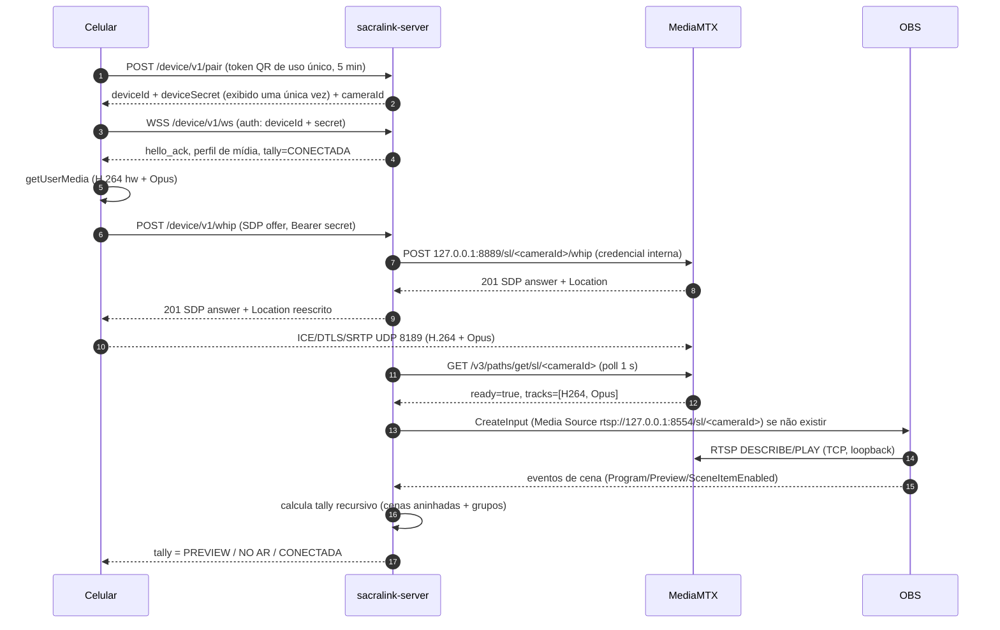

# SacraLink — Plano Técnico (Primeira Entrega)

> Status: **aprovado para Fase 0/1** · Versão do documento: 1.0 · Data: 2026-11-05
>
> Este documento é a base de decisão do projeto. Cada decisão relevante tem um
> ADR correspondente em [`adr/`](adr/). Quando uma decisão depende de prova de
> conceito (PoC), isso está explícito.

---

## 1. Resumo executivo

O SacraLink transforma até **8 smartphones (Android/iOS)** em câmeras sem fio para
o **OBS Studio** rodando no computador Windows da igreja. Os celulares publicam
áudio e vídeo por **WebRTC (WHIP)** diretamente para o computador da igreja — sem
VPS, sem relay em nuvem, sem Docker. Um servidor local (Go) supervisiona o
servidor de mídia (**MediaMTX**), cria as fontes no OBS automaticamente via
**obs-websocket 5.x**, calcula o **tally** (PREVIEW / NO AR) a partir do estado
real do OBS e devolve esse estado aos celulares em tempo real, junto com comandos
remotos (zoom, lente, qualidade).

O produto prioriza **operação real e confiável** em rede local (funciona sem
internet). A conexão por 4G/5G é suportada **quando existe rota de entrada real**
até o computador da igreja (IPv4 público com encaminhamento de porta ou IPv6
global com firewall liberado). Em CGNAT sem IPv6 o sistema informa honestamente
que a conexão externa direta é inviável.

---

## 2. Análise crítica da arquitetura proposta e decisões

A arquitetura sugerida na especificação é sólida. Mantivemos Go, Wails,
React/TypeScript, Tailwind, SQLite, MediaMTX, WebRTC/WHIP, RTSP e Flutter.
As mudanças abaixo têm justificativa técnica:

| # | Proposta original | Decisão | Justificativa |
|---|---|---|---|
| D1 | Um app Wails com backend embutido | **Dois processos**: `sacralink-server.exe` (headless + ícone na bandeja) e `SacraLink.exe` (painel Wails) | Fechar/travar o painel **não derruba o vídeo**. O servidor continua recebendo câmeras com a janela fechada. O Wails v2 não tem bandeja nativa; o servidor headless tem (via `fyne.io/systray`). Permite também abrir o painel em navegador local/tablet no futuro. [ADR-0001](adr/0001-processos-separados.md) |
| D2 | Avaliar Windows Service | **Processo por usuário com início automático no logon** (HKCU\…\Run). Serviço fica como opção futura | O OBS exige sessão interativa de qualquer forma. Um serviço rodaria como LocalSystem (privilégio maior exposto à rede), não pode exibir bandeja (Sessão 0) e complica DPAPI por usuário. Benefício real ≈ zero para este caso. [ADR-0002](adr/0002-sem-windows-service-no-mvp.md) |
| D3 | Celular fala direto com o MediaMTX | **Proxy WHIP no servidor Go**; HTTP/RTSP/API do MediaMTX escutam só em `127.0.0.1` | Uma única porta HTTPS exposta, com nossa autenticação por dispositivo, rate-limit e TLS com pinning. Endpoints internos do MediaMTX nunca ficam acessíveis pela rede. Só a porta ICE (UDP/TCP 8189) do MediaMTX é exposta, e ela só aceita sessões negociadas pelo proxy. [ADR-0003](adr/0003-proxy-whip-e-mediamtx-loopback.md) |
| D4 | SQLite | **SQLite puro Go (`modernc.org/sqlite`)** | Sem CGO → build reproduzível no CI Windows sem toolchain C. |
| D5 | Node.js | **Nenhum servidor Node.js**. Node só em desenvolvimento (build do frontend) | O backend Go cobre todas as responsabilidades. |
| D6 | RTSP vs WHEP no OBS | **Ambos implementados**; RTSP (Media Source) como padrão inicial, WHEP (Browser Source + player local) como alternativa; escolha final por PoC medida | O OBS publica WHIP desde a v30, mas **não há fonte WHEP nativa comprovada** nas versões-alvo. Browser Source (CEF) suporta WebRTC, mas precisa ser medido (latência, CPU, áudio). [ADR-0004](adr/0004-ingestao-obs-rtsp-e-whep.md) |
| D7 | Wails | **Wails v2.17** (estável e madura) | O Wails v3 estabilizou há poucos dias (3.1.0 em 2026-11-01). Como a bandeja está no servidor (D1), o v2 atende sem risco. Migração para v3 é possível depois. |
| D8 | Inno Setup ou WiX | **Inno Setup 6** | Gera `.exe` com assistente, páginas customizadas, desinstalador, atualização preservando dados, e é scriptável no CI. WiX/MSI só compensa para implantação corporativa via GPO, que não é o caso. [ADR-0005](adr/0005-instalador-inno-setup.md) |

---

## 3. Tecnologias e licenças

| Componente | Tecnologia | Licença | Onde roda | Observação |
|---|---|---|---|---|
| Servidor | Go 1.27 | BSD-3 | PC da igreja (binário compilado) | Go **não** é necessário no PC final |
| Servidor de mídia | MediaMTX v1.21 | MIT | PC da igreja (processo filho supervisionado) | Binário redistribuído no instalador |
| Banco | modernc.org/sqlite | BSD-3 | Embutido no servidor | |
| Bandeja | fyne.io/systray | Apache-2.0 | Servidor | |
| Painel | Wails v2 + React 18 + TypeScript + Tailwind | MIT | PC da igreja | Requer **WebView2 Runtime** (já presente no Win 11; o instalador instala no Win 10 se faltar) |
| App móvel | Flutter 3 + flutter_webrtc | BSD-3 / MIT | Android 8+ / iOS 14+ | |
| QR Code (móvel) | mobile_scanner | BSD-3 | | No Android usa Google ML Kit (binário proprietário gratuito) — documentado em [licenças](../licenses.md) |
| Instalador | Inno Setup 6 | Licença própria (permite uso comercial) | CI / dev | |
| OBS | OBS Studio 28+ (obs-websocket 5.x embutido) | GPL-2.0 | PC da igreja | **Não** redistribuímos o OBS. Comunicação apenas via protocolo de rede, sem linkagem |

**Licença do SacraLink:** MIT (compatível com todas as dependências acima; troca
de licença é decisão do mantenedor e pode ser feita antes da 1.0).

**Dependências de desenvolvimento** (apenas na máquina do desenvolvedor/CI): Go,
Node.js + npm, Wails CLI, Flutter SDK, Android SDK/JDK, Xcode (macOS, para iOS),
Inno Setup. **Dependências de execução** (PC final): WebView2 Runtime, MediaMTX
(embutido), OBS Studio (instalado pelo usuário).

---

## 4. Diagrama de componentes



### Portas

| Porta | Protocolo | Bind padrão | Exposição | Uso |
|---|---|---|---|---|
| 7380 | HTTP | 127.0.0.1 | **Nunca** exposta | Admin API + WS do painel + player WHEP para Browser Source |
| 7443 | HTTPS (TLS 1.3) | 0.0.0.0 | LAN (e internet, se o admin habilitar) | Pareamento, WS de controle/tally, proxy WHIP |
| 8189 | UDP + TCP | 0.0.0.0 | LAN (e internet, se habilitado) | Mídia WebRTC (ICE/DTLS/SRTP) do MediaMTX |
| 8554 | RTSP/TCP | 127.0.0.1 | Nunca | OBS Media Source |
| 8889 | HTTP | 127.0.0.1 | Nunca | WHIP/WHEP interno do MediaMTX |
| 9997 | HTTP | 127.0.0.1 | Nunca | API de controle do MediaMTX |
| 4455 | WS | 127.0.0.1 (OBS) | Nunca | obs-websocket |

---

## 5. Fluxo completo de vídeo e áudio



**Codecs:** vídeo **H.264** (encoder de hardware do aparelho), áudio **Opus
48 kHz**. Nenhuma transcodificação no servidor: o MediaMTX remuxa WebRTC → RTSP.
O FFmpeg interno do OBS decodifica H.264 e Opus.

**Áudio:** cada câmera traz seu áudio dentro da mesma fonte do OBS (Media
Source). O mixer do OBS continua sendo o mixer oficial. O SacraLink lê níveis
(`InputVolumeMeters`), muta/desmuta, ajusta volume e offset de sincronização
(`SetInputAudioSyncOffset`). O áudio de retorno **nunca** é reproduzido no
alto-falante do celular que captura.

---

## 6. Integração detalhada com o OBS

### 6.1 Conexão
- obs-websocket 5.x (embutido no OBS ≥ 28). Autenticação SHA-256
  (desafio/salt do protocolo), implementada no cliente Go próprio.
- Endereço padrão `127.0.0.1:4455`. A senha é cifrada com **DPAPI** (escopo do
  usuário do Windows) antes de ir para o SQLite.
- Reconexão automática com backoff exponencial (1 s → 30 s, jitter).
- Detecção da instalação via registro (`HKLM\SOFTWARE\OBS Studio`) e caminho
  padrão; leitura da versão do executável.

### 6.2 Fontes automáticas (idempotente)
Para cada câmera, o SacraLink gerencia dois objetos:
- **Fonte (input):** `SacraLink — Câmera 01` (Media Source ou Browser Source).
- **Cena dedicada:** `SacraLink — Cena Câmera 01`, contendo a fonte.

O mapeamento `cameraId → nome/UUID da fonte e da cena` é persistido
(`obs_source_mappings`). Antes de criar, o servidor procura pelo UUID e depois
pelo nome. Reconexões **não** duplicam fontes. Renomeações feitas no OBS são
seguidas pelo evento `InputNameChanged`. Fontes removidas manualmente são
recriadas **apenas** se o operador permitir (configuração). O SacraLink **nunca
apaga** fontes, cenas ou configurações que não criou.

### 6.3 Tally — definição técnica dos estados

O estado de conexão e o estado de tally são **ortogonais**:

| Estado de conexão | Significado técnico |
|---|---|
| `OFFLINE` | Dispositivo pareado, sem WS de controle ativo |
| `CONNECTING` | WS autenticado, aguardando mídia (sessão WHIP em negociação) |
| `CONNECTED` | WS ativo, sem fluxo de mídia publicado |
| `STREAMING` | MediaMTX reporta o path `ready` com bytes chegando nos últimos 3 s |
| `RECONNECTING` | Fluxo ou WS caiu há < 60 s; retentativas em andamento |
| `ERROR` | Falha não recuperável automaticamente (ex.: codec incompatível, revogado) |

| Tally | Significado técnico |
|---|---|
| `PREVIEW` | Studio Mode ativo **e** a fonte é visível (habilitada) na árvore da cena de Preview |
| `ON_AIR` | A fonte é visível na árvore da cena de **Program** |
| `NONE` | Nenhum dos anteriores |
| `UNKNOWN` | OBS desconectado: **nunca** exibimos NO AR desatualizado |

Algoritmo: busca em profundidade a partir da cena de Program (e da de Preview),
percorrendo itens **habilitados**; itens que são cenas (`OBS_SOURCE_TYPE_SCENE`)
ou grupos (`isGroup`) são expandidos recursivamente, com proteção contra ciclos.
Uma fonte pode estar em `PREVIEW` e `ON_AIR` ao mesmo tempo. Durante uma
transição, o tally só muda quando o OBS emite `CurrentProgramSceneChanged`.

Limitações documentadas: opacidade 0, crop total ou posição fora do canvas não
são detectadas; plugins que injetam fontes fora da árvore de cenas (ex.:
*Downstream Keyer*, *Source Clone*) não são considerados.

O campo `live` indica se o OBS está transmitindo ou gravando. O celular mostra
**● NO AR** quando `ON_AIR` (com aviso "transmissão parada" se `live=false`).

### 6.4 Segurança operacional de cenas
- Com **Studio Mode ativo** (padrão recomendado): "Enviar para Preview" define a
  cena de Preview; "Cortar/Transição" chama `TriggerStudioModeTransition`.
- Com **Studio Mode desativado**: trocar a cena vai **direto ao ar**; o painel
  exige confirmação explícita, a menos que o operador habilite "trocas diretas".
- Iniciar/parar transmissão ou gravação exige confirmação dupla.

### 6.5 Ingestão no OBS — avaliação (PoC)
- **A — RTSP / Media Source** (`ffmpeg_source`, `rtsp_transport=tcp`, buffer
  mínimo, decodificação por hardware): suporte nativo em todas as versões,
  áudio integrado, reconexão automática do próprio OBS.
- **B — WHEP / Browser Source** (página local `http://127.0.0.1:7380/player/<id>`
  com cliente WHEP): potencialmente menor latência; exige "Controlar áudio pelo
  OBS"; consumo de CPU do CEF precisa ser medido.

Metodologia de medição em [`docs/obs/poc-ingestao.md`](../obs/poc-ingestao.md).

---

## 7. Estratégia Wi-Fi e 4G/5G

| Item | Wi-Fi local | 4G/5G |
|---|---|---|
| Meta de latência (captura→OBS) | < 500 ms (a validar) | ≤ 2 s em boas condições (a validar) |
| Perfil padrão | Equilibrado 720p30 ~2,5 Mbps | Econômico 480p30 ~1 Mbps, adaptativo |
| Adaptação | Controle de congestionamento do WebRTC (GCC) + `maxBitrate` no `RTCRtpSender` | Igual, com piso menor e degradação de resolução (`degradationPreference`) |
| Troca de rede | — | Detecção de mudança de conectividade no app → ICE restart via PATCH (RFC 9725) **a validar por PoC com o MediaMTX**; plano garantido: nova sessão WHIP com a mesma identidade e o mesmo path (o OBS reconecta sozinho) |
| Recomendações | 5 GHz, roteador dedicado, PC no cabo | Antena externa/roteador 5G se possível |

Perfis: Automático, Econômico (480p30), Equilibrado (720p30), Alta qualidade
(1080p30), 1080p60 (quando suportado), Personalizado. 4K é evolução futura.

---

## 8. Limitações reais da ausência de VPS

Sem VPS/relay, o celular precisa **alcançar diretamente** o PC da igreja:

1. **IPv4 público + encaminhamento de porta** (7443/TCP e 8189/UDP+TCP) no
   roteador → funciona. DNS dinâmico opcional se o IP mudar.
2. **IPv6 global** no PC e no celular, com firewall liberado → funciona (muitas
   operadoras móveis brasileiras entregam IPv6).
3. **CGNAT (100.64.0.0/10 ou WAN privada) sem IPv6** → **conexão externa direta
   inviável**. STUN apenas descobre o endereço mapeado; ele **não** cria rota de
   entrada. Um TURN local também precisaria ser alcançável externamente, então
   não resolve. Soluções reais: pedir IP público/IPv6 à operadora, ou plano
   empresarial. O diagnóstico do SacraLink detecta e explica esse cenário.
4. **Teste de alcance externo** só é conclusivo feito "de fora": o app móvel
   tem um botão "Testar conexão externa" a ser usado com o Wi-Fi desligado.

UPnP/NAT-PMP: avaliado, **desligado por padrão**; só é usado se o administrador
habilitar conscientemente (fase 4).

---

## 9. Estratégia de instalação Windows

- `SacraLink-Setup-x64.exe` (Inno Setup 6), instalação por máquina em
  `C:\Program Files\SacraLink`; dados por usuário em `%LOCALAPPDATA%\SacraLink`
  (banco, certificados, logs, configuração gerada do MediaMTX) — coerente com o
  servidor rodando como processo do usuário (ADR-0002) e com DPAPI de escopo do
  usuário. Atualização preserva dados.
- Conteúdo: `SacraLink.exe` (painel), `sacralink-server.exe`, `mediamtx.exe` +
  licença, verificação de hash SHA-256 dos componentes no primeiro start.
- WebView2: o instalador verifica e instala o bootstrapper Evergreen se faltar.
- Firewall: regras criadas **somente com consentimento** (página do assistente
  com checkbox), restritas aos executáveis e ao perfil de rede escolhido
  (Privado por padrão). Removidas na desinstalação.
- Desinstalação: encerra o servidor e o MediaMTX, remove regras e atalhos;
  pergunta se deve apagar dados.
- Code signing: o pipeline está preparado (`signtool`), mas exige certificado
  adquirido pelo mantenedor; sem ele o SmartScreen exibirá alerta.

---

## 10. Estrutura do monorepo

```
SacraLink/
  apps/
    server/        # Go: sacralink-server (headless, bandeja, APIs, orquestração)
      cmd/sacralink-server/
      internal/{config,store,obs,tally,media,devices,control,api,netdiag,platform,...}
    desktop/       # Wails v2: SacraLink.exe (painel)
      frontend/    # React + TypeScript + Tailwind (Vite)
    mobile/        # Flutter: SacraLink Camera (Android/iOS)
  packages/
    contracts/     # OpenAPI + JSON Schema do protocolo de controle (versionados)
  configs/         # modelos de configuração (mediamtx.yml template etc.)
  installer/windows/ # script Inno Setup
  scripts/         # build, download de MediaMTX, utilitários de dev
  tests/{integration,e2e,performance}
  docs/{architecture,api,networking,obs,mobile,installation}
  .github/workflows/
```

---

## 11. Critérios de aceitação do MVP

Os 16 critérios da especificação (§20) são rastreados em
[`docs/mvp-checklist.md`](../mvp-checklist.md), cada um com: como testar,
evidência esperada e status (`não iniciado` / `implementado` /
`testado automaticamente` / `validado manualmente`). O MVP **não** é declarado
concluído enquanto o vídeo real do celular não aparecer em uma fonte utilizável
do OBS.

---

## 12. Classificação das funcionalidades

### Confirmadas tecnicamente
- MediaMTX recebendo WHIP (H.264/Opus) e servindo RTSP no Windows sem Docker.
- OBS consumindo RTSP via Media Source.
- obs-websocket 5.x: autenticação, cenas, itens, Studio Mode, criação de fontes,
  eventos, estado de stream/gravação, níveis de áudio.
- Tally recursivo com cenas aninhadas e grupos.
- Pareamento por QR com token de uso único; TLS autoassinado com pinning.
- DPAPI, regras de firewall via `netsh`, autostart via registro.
- Instalador Inno Setup sem exigir runtimes de desenvolvimento.

### Dependentes de prova de conceito
- Latência < 500 ms em Wi-Fi (RTSP vs WHEP no OBS).
- Browser Source + WHEP como alternativa de ingestão.
- Prévia de 8 câmeras no painel com decodificação por hardware do WebView2.
- Reconexão rápida em troca Wi-Fi → 5G (nova sessão WHIP).
- Oito câmeras simultâneas no hardware de referência.

### Dependentes de hardware ou sistema operacional
- Zoom máximo real, troca de lentes físicas (ultra-wide/tele), zoom óptico.
- Foco/exposição por ponto, flash/torch.
- Encoder H.264 de hardware e 1080p60.
- Temperatura/estado térmico (Android `PowerManager` / iOS `thermalState`).
- Operação com tela bloqueada ou app em segundo plano: **não suportado** — iOS
  suspende a câmera em background; o app mantém a tela ativa (wakelock).

### Futuras (fora do MVP)
- Transmissão direta sem OBS, SRT, gravação isolada, replays, PTZ/câmeras IP,
  multistream, overlays, agenda, automação de cenas, app de operador/tablet,
  UPnP/NAT-PMP automático, Windows Service opcional, 4K.

---

## 13. Roadmap técnico priorizado

| Fase | Entregas | Critério de saída |
|---|---|---|
| **0 — Validação** | Este plano, ADRs, PoC MediaMTX→OBS (RTSP e WHEP), publisher de teste WHIP, cliente obs-websocket, medição de latência | Vídeo real chegando ao OBS via SacraLink |
| **1 — App Windows** | Servidor Go, SQLite+migrations, supervisor MediaMTX, ponte OBS, APIs, painel Wails, assistente inicial, instalador | App Windows funcional sem terminal |
| **2 — App móvel** | Flutter: pareamento QR, WHIP, zoom local, controle remoto, tally | Celular funcionando como câmera |
| **3 — Multicâmera** | 8 câmeras, grade, fontes automáticas, Preview/Program, áudio, métricas, testes de carga | Operação estável no hardware de referência |
| **4 — Externo** | Diagnóstico público, TLS/DDNS, adaptação 4G/5G, mobilidade, CGNAT | Celular em 4G até a igreja com rota comprovada |
| **5 — Distribuição** | Logs avançados, segurança, atualização, docs bilíngues, release | Release pública |
| **6 — Futuro** | Itens da seção 12 "Futuras" | — |
